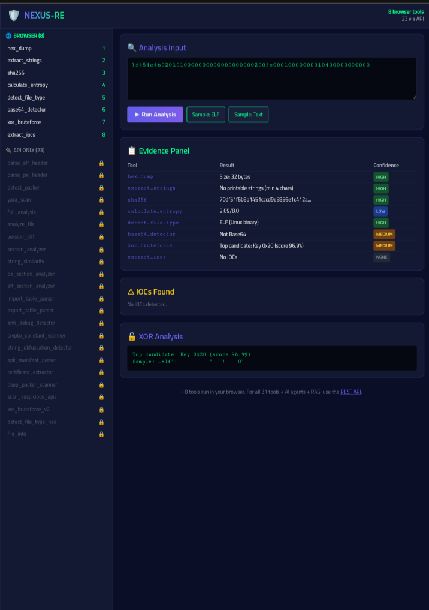

# NEXUS-RE

**AI-Ready Binary Analysis Toolkit - Built entirely on Android.**

NEXUS-RE is an open-source reverse engineering and security analysis platform. It provides **31 static analysis tools**, **4 AI agents**, a **REST API**, and a real-time web dashboard. It runs seamlessly on Android (via Pydroid 3/Termux), Linux, macOS, and Windows with **zero external runtime dependencies**.

[](#) [](#) [](#) [](#)

---

## Live Demo & Screenshot
Experience the real-time web dashboard (8 tools run directly in your browser):
**[Live Demo Link](https://qamar-sobhy-nexus-re-api.static.hf.space)**



---

## Quick Start
**Prerequisites:** Python 3.11+ (Zero runtime dependencies).
```bash
# 1. Clone the repository
git clone https://github.com/qamarsobhy7-source/nexus-re.git
cd nexus-re

# 2. Run the CLI (Interactive Menu)
python nexus_re_v3.py --help

# 3. Start the REST API Server
python api_render.py
```

---

## Features
- **31 Analysis Tools:** Hex Dump, Strings, Hash, Entropy, ELF/PE Parsing, XOR Brute Force, YARA, IOC extraction, and more.
- **4 AI Agents:** Custom ReAct orchestrator for automated threat reasoning.
- **RAG Service:** Pure-Python TF-IDF retrieval over CVE and security docs.
- **Web Dashboard:** 8 tools run entirely in your browser; 23 tools available via API.
- **Zero Dependencies:** Core tools rely only on the Python standard library.

---

## Usage Examples

### 1. CLI Mode
```bash
python nexus_re_v3.py
```

### 2. REST API Mode
```bash
python api_render.py
# Server starts at http://localhost:8000
```

### 3. Python Library
```python
from nexus_re_v3 import full_analysis
report = full_analysis('7f454c46...')
print(report)
```

---

## Supported Formats
| Format | Detection | Deep Analysis |
| :--- | :--- | :--- |
| ELF (Linux) | ✅ | ✅ Full |
| PE (Windows) | ✅ | ✅ Full |
| Mach-O (macOS) | ✅ | ⚠️ Partial |
| PNG/JPEG/PDF/ZIP/GZIP | ✅ | ❌ |
| .NET / APK / EVM / Firmware | 📅 Planned | 📅 Planned |

---

<details>
<summary><b>👉 Click to expand: How NEXUS-RE Works (4-Stage Pipeline)</b></summary>

### Stage 1 - Ingestion
The user provides a target: a file path, a hex string, or a direct question.

### Stage 2 - Tool Selection
The orchestrator selects the appropriate tools based on file type and user intent.

### Stage 3 - Evidence Collection
Every tool returns structured evidence (Result, Source, Confidence, Artifact).

### Stage 4 - Report Generation
Results are merged into a single report with sections: File Type, Entropy, IOCs, Suspicious APIs, Packer, YARA.
</details>

---

<details>
<summary><b>👉 Click to expand: Project Reality (Implemented vs Planned)</b></summary>

| Component | Status | Location |
| :--- | :--- | :--- |
| 31 Analysis Tools | ✅ Working | `nexus_re_v3.py` |
| 4 AI Agents | ✅ Working | `nexus_agents.py` |
| RAG Service (TF-IDF) | ✅ Working | `nexus_rag.py` |
| REST API (24 endpoints) | ✅ Working | `api_render.py` |
| Real Web Dashboard | ✅ Working | `index.html` |
| 56 Tests (100% pass) | ✅ Working | `tests/` |
| Ghidra / Frida Integration | 📅 Planned | Requires desktop OS |
| Real LLMs (Llama 3) | 📅 Planned | Requires GPU |
</details>

---

<details>
<summary><b>👉 Click to expand: The Story Behind This Project</b></summary>

This project was built **entirely on an Android phone** using Pydroid 3 and Termux. This constraint shaped every architectural decision. NEXUS-RE was designed to be a lightweight, dependency-free toolkit that provides professional-grade static analysis without needing a desktop OS.
</details>

---

## Known Limitations (Honest)
- **No Dynamic Analysis:** Frida integration is pending.
- **No real LLM:** The RAG service uses TF-IDF, not neural embeddings.
- **Web UI:** Only 8 tools run in the browser; use CLI/API for all 31.
- **Max File Size:** ~50 MB on Android due to memory limits.

---

## Documentation
For deep dives into the architecture, testing, and setup, please refer to the following:
- [Architecture & Pipeline](docs/architecture.md)
- [API Reference](docs/api.md)
- [Installation & Setup](docs/installation.md)
- [Project Limitations](LIMITATIONS.md)
- [Contributing Guidelines](CONTRIBUTING.md)
- [Security Policy](SECURITY.md)

> ⚠️ **Project Status:** Alpha (v3.0.0). Built entirely on a mobile phone (Pydroid 3). Not a production-ready replacement for Ghidra or IDA Pro.

---

## License & Author
Distributed under the **MIT License**. See `LICENSE` for details.
Created by **Qamar Sobhy** ([@qamarsobhy7-source](https://github.com/qamarsobhy7-source)).